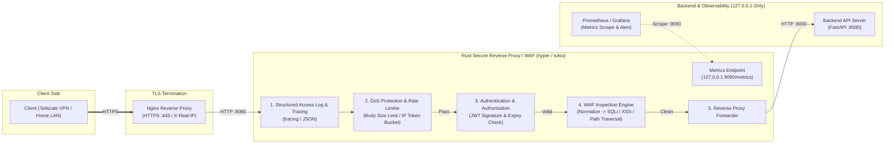

# my-api-gateway - Secure Reverse Proxy & Lightweight WAF in Rust

Rust（`hyper` / `tokio`）で実装した、バックエンドAPI保護のためのセキュア・リバースプロキシ兼軽量 WAF（Web Application Firewall）です。
単なるリクエスト転送にとどまらず、**計算コストに基づく段階的防御パイプライン（DoS対策・認証・攻撃ペイロード検知）、正規化によるWAFバイパス対策、構造化ログとメトリクスによる可観測性（Observability）の確保**を目的として設計・開発しています。

---

## 設計・セキュリティ方針 (Design & Security Policy)

- **責務の分離と最小攻撃面（Attack Surface Reduction）:** 認証・認可、レート制限、基本的な攻撃フィルタリングをゲートウェイ層に集約し、後段のバックエンド（FastAPI）を `127.0.0.1` のみにバインドすることで、ビジネスロジックへの直接アクセスと不正リクエストの到達を遮断します。
- **計算コストに基づく防御パイプライン:** 処理負荷の低い「ボディサイズ制限・IPレート制限」を最前段に配置し、暗号演算を伴う「JWT署名検証」や文字列正規化・検査を伴う「WAFフィルタリング」への到達前にDoSトラフィックを破棄することで、ゲートウェイ自体のリソース枯渇を防ぎます。
- **WAFバイパス耐性と誤検知（False Positive）の制御:** 検査前のURLデコード・文字種正規化によりエンコード回避を防ぎつつ、正常な業務データ（正当な記号を含むJSON等）を誤遮断しないようユニットテスト・結合テストによる検証を組み込んでいます。
- **信頼境界（Trust Boundary）の厳格化:** 前段のTLS終端プロキシ（Nginx）から付与される `X-Real-IP` は、直接のTCP接続元が信頼済みループバック（`127.0.0.1`）である場合のみ採用し、ヘッダー偽装によるレート制限回避（IP Spoofing）を防止します。

---

## システム構成概要 (Architecture)



---

## 技術スタック (Tech Stack)

- **Proxy / WAF Core:** Rust (Edition 2021), `tokio`, `hyper` (v1), `hyper-util`, `http-body-util`
- **Security & Auth:** `jsonwebtoken` (JWT検証), `rustls` / `regex` / `percent-encoding` (正規化・WAFルール)
- **Observability:** `tracing`, `tracing-subscriber` (JSON構造化ログ), Prometheus Metrics Exporter
- **Upstream Backend (検証用):** Python, FastAPI, Uvicorn
- **Quality & CI:** `rustfmt`, `clippy`, `cargo-audit` (CVE監査), GitHub Actions
- **Target Deployment:** Raspberry Pi 5 (64-bit Linux / systemd) ※[homelab](https://github.com/your-username/homelab) 環境へ統合予定

---

## 開発ロードマップ (Development Roadmap)

- [ ] **Step 1:** 基本HTTPリバースプロキシ（`:8080` → `:8000`）と `tracing` によるJSON構造化アクセスログの実装
- [ ] **Step 2:** リクエストボディサイズ上限チェックと、信頼済みプロキシ検証付きIPレート制限（Token Bucket / `429` 応答）
- [ ] **Step 3:** `Authorization` ヘッダーのJWT検証（署名・有効期限チェック / `401` 応答）
- [ ] **Step 4:** URLデコード・正規化パイプラインと簡易WAF（SQLi / XSS / Path Traversal検知・`403` 応答）
- [ ] **Step 5:** 管理用ポート（`:9090`）での `/metrics` 公開と Prometheus / Grafana 連携
- [ ] **Step 6:** 攻撃ペイロード・誤検知テスト、GitHub Actions CI（`clippy` / `cargo-audit`）、ベンチマーク計測および Raspberry Pi 5 への実戦配備

---

## ディレクトリ構成 (Directory Structure)

```text
my-api-gateway/
├── .github/
│   └── workflows/       # CI (cargo test / clippy / cargo-audit)
├── proxy/               # Rust製 リバースプロキシ / WAF 本体
│   ├── Cargo.toml
│   ├── Cargo.lock
│   ├── rustfmt.toml
│   └── src/
├── backend/             # 検証用 FastAPI バックエンドサーバー
├── docs/                # アーキテクチャ設計書・WAFルール仕様・ベンチマーク結果
└── README.md
```

---

## ローカル開発・起動手順 (Local Setup)

### 1. 検証用バックエンド（FastAPI）の起動
```bash
cd backend
uv sync
uv run uvicorn main:app --host 127.0.0.1 --port 8000
```

### 2. Rust リバースプロキシの起動
```bash
cd proxy
cargo run
```

### 3. 動作確認・品質チェック
```bash
# プロキシ経由での疎通確認
curl -i [http://127.0.0.1:8080/health](http://127.0.0.1:8080/health)

# フォーマット・静的解析・依存クレートのCVE監査
cd proxy
cargo fmt --check
cargo clippy -- -D warnings
cargo audit
```

---

## Git・開発運用ルール

本リポジトリでは、実務のチーム開発基準に沿った変更履歴の可読性とコード品質を担保するため、以下の基準で運用しています。

### ブランチ運用
- **`main` への直接プッシュ禁止:** すべての変更は GitHub Issue と紐づけた作業用ブランチを作成し、Pull Request 経由でマージします。
- **ブランチ命名規則:** `<type>/<issue番号>-<簡潔な概要>`
  - 例: `feat/1-basic-reverse-proxy`, `feat/2-ip-rate-limiter`, `fix/5-url-decode-bypass`

### コミットメッセージ規則
[Conventional Commits](https://www.conventionalcommits.org/) に準拠し、変更種別と対象スコープを明記します。
- 例: `feat(waf): add URL normalization before SQLi pattern inspection`
- 例: `test(proxy): add false-positive test cases for JSON payloads`

### Pull Request セルフマージ前の確認基準
- `cargo fmt --check`、`cargo clippy -- -D warnings`、`cargo test`、`cargo audit` がすべてエラー・警告ゼロで通過していること
- 差分（Files changed）に秘密鍵・JWTシークレット・固有IP等の機密情報がハードコードされていないこと
- マージ完了後に作業用ブランチを削除し、ブランチ一覧をクリーンに保つこと
